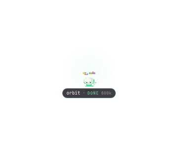

<div align="center">


# Orbit

**A desktop pet that shows what your Claude Code and Cursor agent sessions are doing.**

[](LICENSE)
[](#install)
[](https://nodejs.org)
[](https://tauri.app)



A small creature floats on your desktop in a transparent, always-on-top window. It breathes and glows blue while an agent works, turns amber when something needs you, throws confetti when a run finishes, and dozes when nothing is happening. It grows as you spend tokens.

[Download releases](https://github.com/hector-mendoza/orbit/releases) · [Quick start](#quick-start) · [Cursor setup](#cursor-agent-support)

</div>

---

## Quick start

**macOS (prebuilt app)**

```bash
# 1. Download Orbit.dmg from Releases and drag Orbit to Applications
#    https://github.com/hector-mendoza/orbit/releases

# 2. Wire up Claude Code + Cursor hooks
curl -fsSL https://raw.githubusercontent.com/hector-mendoza/orbit/main/scripts/install.sh | bash

# 3. Restart Claude Code sessions, reload Cursor, launch Orbit
```

**From source (any OS)**

```bash
git clone https://github.com/hector-mendoza/orbit.git
cd orbit
npm install
npm run install-hooks
npm run dev
```

## Features

- **One pet, all sessions** — merges Claude Code and Cursor activity; shows whichever source updated most recently.
- **Four states** — `working`, `waiting`, `done`, `idle` (auto-idle after 5 minutes with no update).
- **Growth** — size tracks token usage (log scale; cache reads excluded).
- **Seven skins** — planet, cat, ghost, bloub, gloop, spark, wisp (tray or right-click to switch).
- **Click to open project** — opens `cwd` in Cursor, VS Code, or your configured editor.
- **Menu bar / tray only** — no dock icon, no window chrome; optional Open at Login.
- **Private** — reads local hook files only; no telemetry, no network calls for status.

| State | Typical trigger | Pet behaviour |
| ----- | --------------- | ------------- |
| `working` | Prompt submitted, tools running | Gentle bob, soft blue glow |
| `waiting` | Permission / approval hooks | Amber glow, shake |
| `done` | Agent turn finished | Confetti, green glow |
| `idle` | No update for 5+ minutes | Still, slow blink |

## Install

### macOS

1. Download **`Orbit.dmg`** from [Releases](https://github.com/hector-mendoza/orbit/releases).
2. Open the DMG and drag **Orbit** to Applications.
3. Run the hook installer (see [Quick start](#quick-start)).

> **Gatekeeper:** The app is unsigned. On first launch, use **System Settings → Privacy & Security → Open Anyway**, or:
>
> ```bash
> xattr -dr com.apple.quarantine /Applications/Orbit.app
> ```

### Windows

1. Download **`Orbit_*_x64-setup.exe`** or **`.msi`** from [Releases](https://github.com/hector-mendoza/orbit/releases).
2. Install, then register hooks in **Git Bash** or **WSL**:
   ```bash
   curl -fsSL https://raw.githubusercontent.com/hector-mendoza/orbit/main/scripts/install.sh | bash
   ```
3. Restart Claude Code; reload Cursor.

### Linux

1. Download **`.AppImage`** or **`.deb`** from Releases.
2. Install or run the AppImage, then:
   ```bash
   curl -fsSL https://raw.githubusercontent.com/hector-mendoza/orbit/main/scripts/install.sh | bash
   ```

### Build from source

Requires **Node 18+**, **Rust** (for Tauri), and platform [Tauri prerequisites](https://tauri.app/start/prerequisites/).

```bash
npm install
npm run install-hooks
npm run build          # release binary in src-tauri/target/release/bundle/
```

Prefer **`npm run dev`** while iterating; use the installed app (not `target/debug`) for **Open at Login**.

## How Orbit detects sessions

Orbit does not talk to Claude or Cursor over the network. **Lifecycle hooks** run small scripts on your machine and write JSON status files under `~/.claude-orb/`.

### Pluggable sources

| Source | Config | Writer |
| ------ | ------ | ------ |
| **Claude Code** | `~/.claude/settings.json` hooks | `~/.claude-orb/update-status.sh` (`claude-code`) |
| **Cursor** | `~/.cursor/hooks.json` | same script (`cursor`) |
| *Future* | add `~/.claude-orb/sources/<name>.json` | your hook script |

The app reads `~/.claude-orb/sources/*.json`, picks the **newest `timestamp`**, and shows that state. Legacy `status.json` is still read for compatibility.

### Claude Code

Hooks on `UserPromptSubmit`, `Notification`, and `Stop` map to `working`, `waiting`, and `done`. The hook payload (stdin JSON) supplies `session_id`, `cwd`, and `transcript_path` for token growth.

### Cursor agent support

[Cursor hooks](https://cursor.com/docs/hooks) (`~/.cursor/hooks.json`) are registered by `install.sh`:

- **Working** — `beforeSubmitPrompt`, `preToolUse`, `postToolUse`, `afterFileEdit`, tool completion hooks, etc.
- **Waiting** — `beforeShellExecution`, `beforeMCPExecution`, `beforeReadFile` (approval-style steps).
- **Done** — `stop`, `sessionEnd`.

**Limits:**

- Hook commands use **`bash`** — on Windows use Git Bash/WSL.
- **Cloud Agents** on remote VMs update status on *that* machine, not your desktop pet unless you run Orbit there too.
- **`transcript_path`** must be enabled in Cursor for token growth from Cursor sessions (same idea as Claude transcripts).
- Cursor must load hooks (reload window after install).

Re-register Cursor only:

```bash
python3 scripts/install-cursor-hooks.py
```

## Configuration

All settings live in `~/.claude-orb/config.json` (merged per key):

| Key | Default | Purpose |
| --- | ------- | ------- |
| `skin` | `planet` | Active creature skin |
| `compact` | `false` | Smaller window |
| `hide_project` | `false` | Hide project name in HUD |
| `dock_edge` | `none` | Snap to screen edge |
| `editor` | *(auto)* | App name/binary for click-to-open |

Growth curve constants are in [`src/config.js`](src/config.js) (`GROWTH_SOURCE`, `GROWTH_RANGE`).

### Status file shape

```json
{
  "state": "working",
  "source": "cursor",
  "project": "orbit",
  "cwd": "/Users/you/Developer/orbit",
  "timestamp": "2026-11-22T20:15:00Z",
  "session_id": "conv-abc",
  "tokens": 128400,
  "tokens_total": 1364395
}
```

## Using the pet

| Action | Result |
| --- | --- |
| **Click** | Open project folder in editor |
| **Drag** | Move window |
| **Right-click** | Cycle skins |
| **Tray** | Skins, compact, hide project name, login item, quit |

## Troubleshooting

| Problem | What to try |
| ------- | ----------- |
| Pet stuck on **idle** | Run `install.sh` again; restart Claude Code / reload Cursor; check `~/.claude-orb/sources/` updates when you prompt. |
| **Claude** hooks missing | `npm run install-hooks`; confirm `~/.claude/settings.json` contains `# orbit-hook`. |
| **Cursor** hooks missing | `python3 scripts/install-cursor-hooks.py`; confirm `~/.cursor/hooks.json` contains `# orbit-cursor-hook`. |
| **Windows** hooks silent | Use Git Bash; ensure `bash` and `python3` are on PATH for Cursor. |
| **Can't open** macOS app | Remove quarantine (`xattr` above) or build from source. |
| Wrong **editor** on click | Set `"editor": "Cursor"` or `"Visual Studio Code"` in `config.json`. |
| **Growth** flat | Transcript path missing or token fields empty; check hook payload has `transcript_path`. |

Debug path shown in devtools: `read_status` returns the merged file path metadata in the Tauri app.

## Developing

```bash
npm run preview          # http://localhost:4317 — cycles states
# ?state=waiting&skin=cat&tokens=25000000
npm run test:status      # status writer unit tests
npm run lint:rust        # fmt + clippy
```

Architecture and skin authoring: see [CONTRIBUTING.md](CONTRIBUTING.md).

## Contributing

PRs welcome — especially new skins (one file + tray registration). See [CONTRIBUTING.md](CONTRIBUTING.md).

## License

[MIT](LICENSE) © 2026 Hector Mendoza · [THIRD_PARTY_NOTICES.md](THIRD_PARTY_NOTICES.md)

If Orbit saves you a trip to the terminal, you can [buy me a coffee](https://buymeacoffee.com/hectormendoza) — optional, no gates.